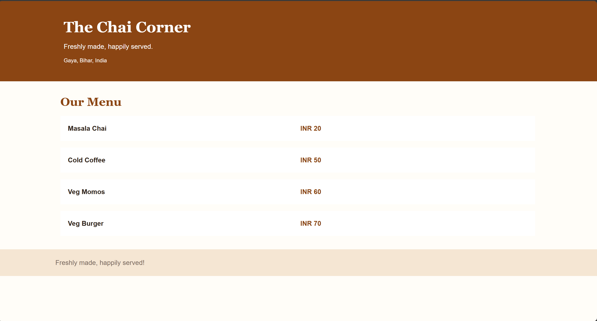
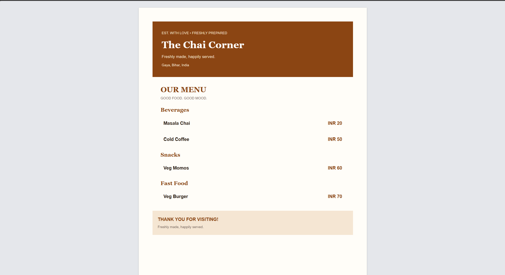
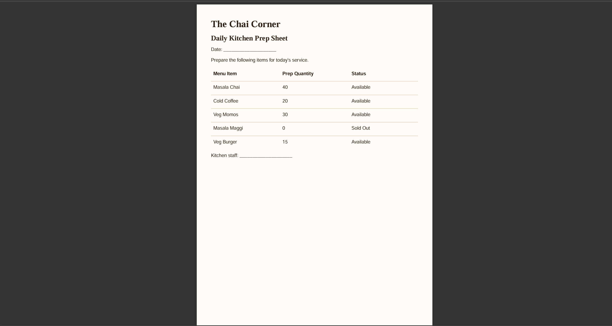
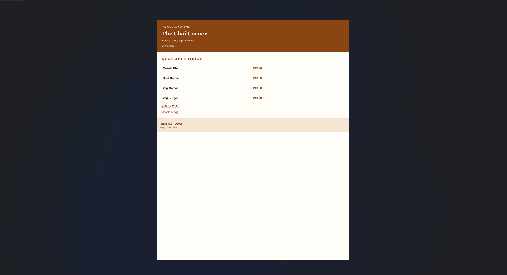
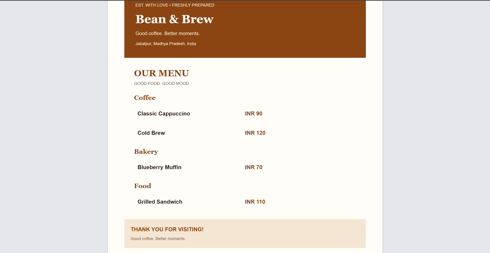
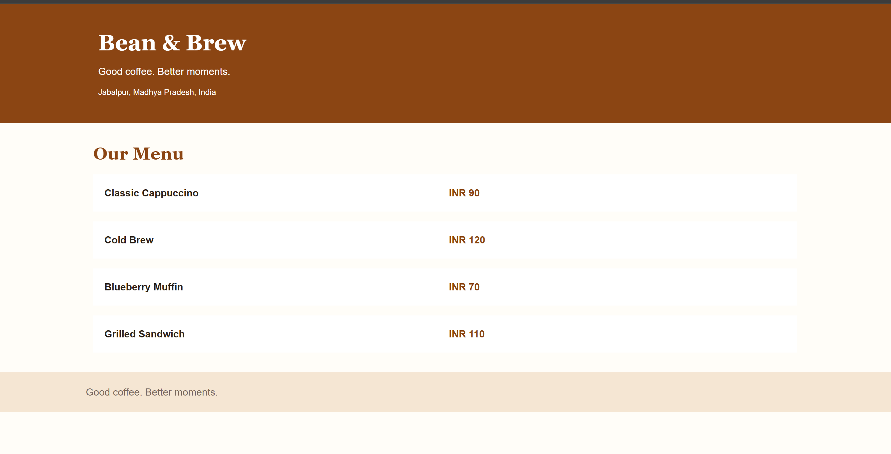
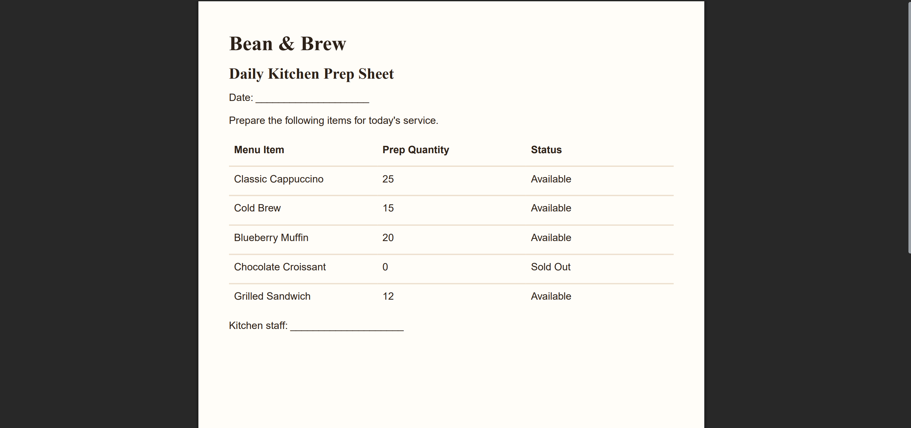
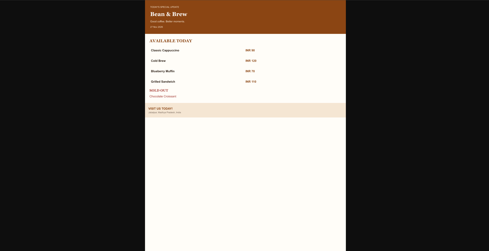

# ☕ ChaiBoard

**One menu. One source of truth. Four daily content outputs.**

ChaiBoard is a reusable, white-label content kit designed for independent cafés. It helps café owners maintain consistent menu information across customer-facing menus, counter displays, kitchen preparation sheets, and WhatsApp updates.

Built using **React, Hyper Elements, and Vite** for the Hyper Elements Template Challenge.

## ✨ Features

- **Customer Digital Menu:** Displays available menu items and automatically hides sold-out items.
- **Printable Counter Menu:** Generates a clean, category-wise menu for counter display.
- **Kitchen Prep Sheet:** Shows preparation quantities and item availability, including sold-out items.
- **WhatsApp Daily Update:** Generates a shareable daily menu update as a PNG image.
- **White-label Design:** Reuse the same templates with different café names, menus, prices, and branding.
- **Two Café Demonstrations:** Switch between two fictional café brands to see the templates in action.
- **Data Validation:** Checks menu data for missing names, duplicate IDs, invalid prices, and availability errors.

## 🏪 Demo Cafés

ChaiBoard includes two fictional café demonstrations:

| Feature | The Chai Corner | Bean & Brew |
|---|---|---|
| Location | Gaya, Bihar | Jabalpur, Madhya Pradesh |
| Brand style | Warm brown and cream | Green and cream |
| Menu | Tea, coffee, snacks | Coffee, bakery, food |
| Currency | INR | INR |

Use the café switcher on the homepage to explore both brands and compare their generated outputs.

*All café information, prices, and preparation quantities are demonstration data.*

## 📦 Four Generated Outputs
## 📸 Project Screenshots

### The Chai Corner

| Customer Digital Menu | Printable Counter Menu |
|---|---|
|  |  |

| Kitchen Prep Sheet | WhatsApp Daily Update |
|---|---|
|  |  |

### Bean & Brew

| Customer Digital Menu | Printable Counter Menu |
|---|---|
|  |  |

| Kitchen Prep Sheet | WhatsApp Daily Update |
|---|---|
|  |  |

### 1. Customer Digital Menu
- Displays available products.
- Automatically hides sold-out items.
- Uses café-specific branding and pricing.

### 2. Printable Counter Menu
- Displays menu items in a clean layout.
- Organizes items by category.
- Uses the café's branding.

### 3. Kitchen Prep Sheet
- Displays preparation quantities.
- Shows availability status.
- Retains sold-out items for kitchen awareness.
- Supports PDF generation.

### 4. WhatsApp Daily Update
- Generates a shareable PNG image.
- Includes café branding and menu information.
- Designed for daily customer communication.

## 🛠️ Tech Stack

- React
- JavaScript
- Vite
- Hyper Elements
- Node.js
- TSX
- React PDF Renderer
- Satori
- Resvg

## 📁 Project Structure

```text
cafe-launch-kit/
│
├── public/
│   └── demos/
│       ├── chai/
│       │   ├── customer-menu.html
│       │   ├── counter-menu.html
│       │   ├── kitchen-prep-sheet.pdf
│       │   └── whatsapp-daily-update.png
│       │
│       └── bean/
│           ├── customer-menu.html
│           ├── counter-menu.html
│           ├── kitchen-prep-sheet.pdf
│           └── whatsapp-daily-update.png
│
├── scripts/
│   ├── testCustomerMenu.mjs
│   ├── testCounterMenu.mjs
│   ├── testKitchenPrep.mjs
│   ├── testWhatsAppUpdate.mjs
│   ├── generateKitchenPDF.mjs
│   ├── generateWhatsAppPNG.mjs
│   └── validateCafeData.mjs
│
├── src/
│   ├── data/
│   │   ├── cafeData.js
│   │   ├── beanBrewData.js
│   │   └── activeCafe.js
│   │
│   ├── templates/
│   │   ├── CustomerMenu.jsx
│   │   ├── CounterMenu.jsx
│   │   ├── KitchenPrepSheet.jsx
│   │   └── WhatsAppUpdate.jsx
│   │
│   ├── theme/
│   │   └── cafeTheme.js
│   │
│   ├── App.jsx
│   └── App.css
│
├── index.html
├── package.json
├── package-lock.json
└── vite.config.js
```

## 🚀 Getting Started

### Prerequisites

- Node.js
- npm

### Installation

Clone the repository:

```bash
git clone https://github.com/Sumit-programmer-787/cafe-launch-kit.git
```

Navigate into the project directory:

```bash
cd cafe-launch-kit/cafe-launch-kit
```

Install dependencies:

```bash
npm install
```

Start the development server:

```bash
npm run dev
```

Open the local URL displayed in your terminal.

## 🔄 Switching Between Cafés

Open:

```text
src/data/activeCafe.js
```

Choose the café you want to generate outputs for:

```js
const activeCafe = "chai";
```

For Bean & Brew:

```js
const activeCafe = "bean";
```

The active café dataset is then used by the output-generation scripts.

## ⚙️ Generate the Outputs

Run the following commands from the project root.

**Customer Menu**

```bash
npx tsx scripts/testCustomerMenu.mjs
```

**Counter Menu**

```bash
npx tsx scripts/testCounterMenu.mjs
```

**Kitchen Prep PDF**

```bash
npx tsx scripts/generateKitchenPDF.mjs
```

**WhatsApp PNG**

```bash
npx tsx scripts/generateWhatsAppPNG.mjs
```

**Validate Café Data**

```bash
npx tsx scripts/validateCafeData.mjs
```

After generating the files, copy the outputs into the appropriate folder under `public/demos/` to update the corresponding café demonstration.

## 🎯 Project Goal

The goal of ChaiBoard is to demonstrate how reusable templates and a shared data source can simplify everyday content management for independent cafés.

Instead of manually updating multiple formats, café owners can maintain their information in one structured dataset and generate consistent outputs for customers and staff.

## 👨‍💻 Author

**Sumit Kumar**

- GitHub: [Sumit-programmer-787](https://github.com/Sumit-programmer-787)
- Project Repository: [ChaiBoard](https://github.com/Sumit-programmer-787/cafe-launch-kit)

---

*Built with React and Hyper Elements for the Hyper Elements Template Challenge.*